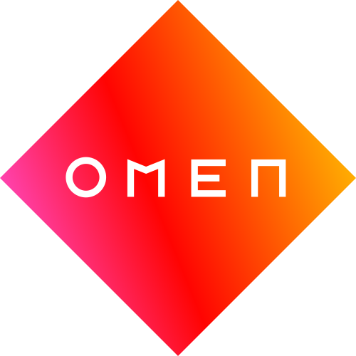

<p align="center">
  
</p>

# Omen Control Alpha 1.0V


Native Intel macOS fan control for the tested **HP OMEN 16-wf1xxx / board 8C78 / BIOS F.15**. Original app, driver and tools are MIT licensed. This community project is not an HP product.

[Installation](INSTALLATION.md) · [Limitations and risks](Docs/LIMITATIONS.md) · [Release notes](Docs/RELEASE-NOTES.md) · [Power helper](Docs/POWER-HELPER.md) · [License](LICENSE)

## What it does

- Independent CPU/GPU fan readback and manual requests, animated fan illustrations, one-minute RPM history, expandable temperature cards.
- Auto, Eco (30%), Manual, Performance (full), and temperature-curve profiles.
- Compact translucent menu panel with separate fan sliders, Apply, Dashboard and Settings. Native materials follow macOS appearance; controls use the system accent color.
- Settings for °C/°F, Dock visibility while windows are open, background fan service, and power-helper approval.
- **Power Profile** separates local battery/AC fan preferences from macOS Low Power Mode.

## Fan control

Auto returns cooling to firmware control. Manual requests 0–100% for each fan; 1–100% scales that fan's own maximum and clamps to its minimum. **0% means Auto, not fan stop.** This BIOS cannot stop the fans through the tested method. Performance requests full fans; it does not change CPU/GPU power limits.

The tested firmware table is CPU 2000–6000 RPM and GPU 2300–6300 RPM. Readback is in 100-RPM steps and can differ from a target while settling. Apply is disabled after an accepted request until a relevant setting changes.

Both animated rotors use optional bundled layers, with a built-in Core Graphics fallback. They rotate independently from measured RPM, at 1/240 speed for visibility. Stationary housing and rotating blades are composited into each frame; speed changes retain phase. Reduce Motion freezes the animation. Missing RPM stops it. CPU and GPU temperature cards show detected hardware names and matching icons when supplied. GPU artwork follows the detected PCI vendor, with a small transparent NVIDIA logo for NVIDIA hardware. Optional local artwork in `Resources/LocalFanArtwork` is omitted from the public source export and public installer; source-only builds use the fallback.

Curves follow the hotter CPU/GPU temperature and need both sensors. Missing/stale temperature data exits or disables curve control. CPU firmware temperature is not used as a substitute for GPU temperature. GPU readings use SMC when exposed, otherwise a nonblocking read-only NVIDIA RM thermal query through the installed graphics driver. That fallback is not confirmed for every driver.

The driver has a 20-second lease; the app sends a heartbeat every three seconds. Disconnect, expiry, sleep/shutdown and selected telemetry faults request firmware Auto. CPU firmware temperature at 90°C requests Auto; the app also boosts manual cooling under serious/critical thermal conditions. These are fallbacks, not a guarantee against every hardware/firmware fault.

## Power Profile

The panel reads current settings with `pmset -g custom`, including when the app returns to the foreground. It preserves drafts if the live system changes. Apply stays disabled until an effective request differs from the current policy or accepted local fan preferences. Reverting an edit disables it again.

Changing only fan-profile preferences does not require administrator access. Inactive per-source fan selections do not count as changes until source following is enabled. Enable source following to configure the battery and plugged-in fan choices; manual/curve choices reuse accepted settings.

Low Power Mode is a protected macOS setting. Open Settings → **Enable power access…**, then approve OMEN Control in macOS Login Items & Extensions if requested. After approval, a narrow on-demand helper applies only battery/AC `lowpowermode` Boolean changes; the app does not invoke an administrator-password script for every Apply. The app rereads current settings before a system change and verifies them afterward. It reports errors/timeouts rather than claiming success. Unsupported/missing policies are shown as unavailable. Some Hackintosh installations report AC only; the app does not invent a battery policy.

Approval is handled by macOS and may require an administrator once, and again if the service is revoked or its signed identity changes. The helper must be in the complete `/Applications/OmenControl.app` bundle. Local ad-hoc builds are not equivalent to Developer-ID-signed distribution; service approval still needs a live desktop test on the target machine. See [Power helper](Docs/POWER-HELPER.md).

## Background service and Dock

The menu-bar controller starts quietly at login when enabled. Closing its windows leaves fan control running. The Dock icon appears only while a dashboard or Settings window is open, if that setting is enabled.

Turning the background fan service off requests Auto for this app's manual lease, closes the client, stops polling and OMEN-key handling, and disables quiet login. Settings remains accessible. This switch does not unload the kernel extension. Power access is a separate macOS-managed helper and can be disabled in Settings.

## Efficiency

Hardware/fan monitoring runs every three seconds; the OMEN key is polled every 350 ms. GPU thermal queries are separate, at most every five seconds when SMC does not expose the GPU. Fan views draw at up to 60 FPS while visible; closing the dashboard stops their animation timers. Power policy is read on activation and when needed for changes, not every heartbeat. The privileged helper launches on demand and has no polling loop.

CPU use, memory use and battery overhead have not been benchmarked on hardware. No percentage or battery-life claim is made.

## Open and build in Xcode

Open `OmenControl.xcodeproj`, select OmenControl → My Mac, then Run. Quit the installed app first because only one instance may own the fan lease. The project includes the helper sources and builds/embeds its executable and launch-daemon plist automatically. Debug builds can exercise the UI; helper registration requires the full app installed in Applications. The app targets Intel macOS 13+ without App Sandbox for its allowlisted IOKit clients.

Alternatively:

```sh
./build-app.sh
swift run --disable-sandbox OmenCoreChecks
xcrun clang++ -std=c++17 Driver/test-fan-policy.cpp -o /tmp/omen-policy-checks
/tmp/omen-policy-checks
```

`build-app.sh` produces `dist/OmenControl.app`, including the fan renderer and embedded power helper, with local ad-hoc signatures. It does not install/change EFI or register the helper. Copy the complete app to Applications; approve power access explicitly in Settings. Building/running from Xcode does not install kernel code.

The separate bridge source/build script targets the tested Intel machine and macOS 26.5 SDK. See Driver/PROTOCOL.md and INSTALLATION.md before touching EFI. The 1.0 experimental PKG is built separately using `Scripts/build-release.py --validator /path/to/ocvalidate`. Read INSTALLATION.md before running it; the installer modifies the mounted boot EFI only on the supported configuration.

## Source layout

- `Sources/OmenControl`: SwiftUI/AppKit UI, telemetry, fan client, power settings/client and fan renderer.
- `Sources/OmenCore`: request validation, interpolation, animation phase and power-policy parsing.
- `Sources/PowerProtocol`: narrow XPC contract, command allowlist and caller-UID policy.
- `Sources/OmenPowerHelper`: on-demand privileged service, restricted to the active console user and two power settings.
- `Sources/SMCReader`: read-only SMC/NVIDIA thermal access.
- `Driver`: board-specific OmenFanBridge 0.4.0 and boundary tests.
- `Resources/LaunchDaemons`: SMAppService daemon declaration bundled inside the app.
- `Installer`: separately documented experimental EFI installer sources; included in the combined 1.0 PKG.
- `Scripts`: app build, source export, project generation and release tooling.

## Diagnostics and sharing

Use Diagnostics in the dashboard for sensor/driver errors. Keep personal hardware dumps, EFI configs, serials, backups and install records private. The exported source ZIP is allowlisted; do not upload the whole private workspace. The native Xcode project and README are included in the ZIP. See Docs/GITHUB-RELEASE.md for publishing later.

## Licenses and references

Original code is MIT; retain LICENSE and THIRD-PARTY-NOTICES.md. NVIDIA thermal ABI notices, the separate OpenCore validator BSD notice and HP/OMEN logo attribution remain intact. MIT does not grant trademark rights. No graphics, audio, Wi-Fi or personal EFI files are bundled in the source handoff.

Protocol references: [Linux hp-wmi](https://github.com/torvalds/linux/blob/master/drivers/platform/x86/hp/hp-wmi.c), [OmenMon](https://github.com/OmenMon/OmenMon), and investigation of the tested machine's ACPI. The implementation is board-specific; the firmware protocol does not depend on macOS.

The default Overview includes fan controls. Power Profile remains a separate page without scrolling. Settings → Appearance offers Chip Image or Product Image. The button below Settings switches between Cooling and Power Profile.

## Release files

The release includes an Intel app ZIP, combined experimental PKG, source ZIP with the native Xcode project, README, limitations, release notes and SHA-256 hashes. The PKG is unsigned and not notarized. Building it does not install it or change the running machine’s EFI. Installation requires administrator authentication, a mounted supported boot EFI and a restart. The app starts quietly at login; power-helper approval is a separate explicit step in Settings.

The window uses native point-size typography with AppKit-owned bounds. Overview and Power Profile share stable window bounds. Navigation and profile edits do not resize the window. The host does not resize the window from SwiftUI intrinsic content estimates, and window size is capped to the screen’s usable bounds.

### Local artwork installer

`Scripts/build-release.py --validator /path/to/ocvalidate --local-artwork` creates `dist/LocalRelease` and a Local-All-Files ZIP with the optional local artwork preserved. These private copies are outside the original-code MIT grant; do not treat them as redistribution-ready. The public `dist/Release` installer and allowlisted source export omit local artwork and use the built-in fallback. Both variants include the same app code, power helper and bridge.
